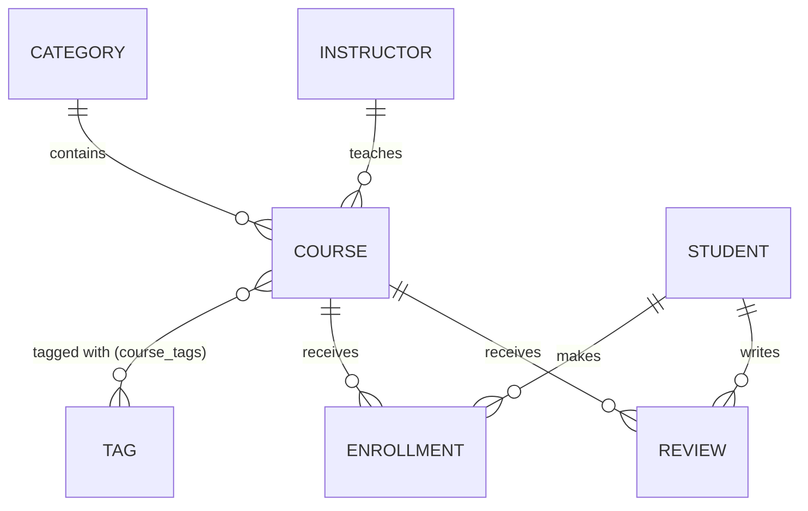

# CourseHub – Online Course Platform API

DS1 mini project – Spring Boot, Spring Data JPA, MySQL, Postman.

## 1. Context

CourseHub is the backend of an online learning platform. **Instructors** publish **courses** that belong to a **category** and carry several **tags**. **Students** enroll in courses (with a progress and a status) and can leave a **review** once enrolled.

The API is a REST API (JSON over HTTP) with a layered architecture:

```
Client (Postman) -> Controller -> Service -> Repository (Spring Data JPA) -> MySQL
```

## 2. Technologies

- Java 17, Spring Boot 3.5 (Spring Web, Spring Data JPA, Validation)
- MySQL (any MySQL 8+), Hibernate as JPA provider
- No Lombok: getters, setters and constructors are written explicitly, so the project compiles
  in any IDE (Eclipse/Spring Tools, IntelliJ, VS Code) without plugins or annotation processing
- Postman for functional tests, JUnit + MockMvc + H2 for automated tests

## 3. Data model



| Entity | Main fields | Notes |
|---|---|---|
| `Category` | name (unique), description | `@OneToMany` courses |
| `Instructor` | firstName, lastName, email (unique), bio | `@OneToMany` courses |
| `Tag` | name (unique) | `@ManyToMany` courses (inverse side) |
| `Course` | title, description, price, durationHours, level | `@ManyToOne` category and instructor, `@ManyToMany` tags (owning side, table `course_tags`) |
| `Student` | fullName, email (unique), birthDate | `@OneToMany` enrollments and reviews |
| `Enrollment` | student, course, enrolledAt, progress (0-100), status | Unique (student, course). Status: ACTIVE, COMPLETED, CANCELLED |
| `Review` | student, course, rating (1-5), comment, createdAt | Unique (student, course) |

Validation is declared on the entities: `@NotBlank`, `@Size`, `@Email`, `@Min`, `@Max`, `@PositiveOrZero`, `@Past`, `@NotNull`.

## 4. Business rules (service layer)

- Names/emails that must be unique are checked before saving (409).
- A category, instructor, student or course **cannot be deleted** while other data still depends on it (409).
- Deleting a tag first detaches it from its courses.
- A student can enroll only once in a course (409).
- A **cancelled enrollment cannot be modified** (422). 100 % progress automatically sets the status to COMPLETED.
- Only an enrolled (non-cancelled) student can review a course (422), and only once (409).

## 5. REST API

All entities have full CRUD: `GET /api/<entity>`, `GET /api/<entity>/{id}`, `POST`, `PUT /{id}`, `DELETE /{id}`.

| Resource | Base path | Body for POST / PUT |
|---|---|---|
| Categories | `/api/categories` | Category |
| Instructors | `/api/instructors` | Instructor |
| Tags | `/api/tags` | Tag |
| Students | `/api/students` | Student |
| Courses | `/api/courses` | Course (relations given as `categoryId`, `instructorId`, `tagIds`) |
| Enrollments | `/api/enrollments` | POST: `studentId`, `courseId`. PUT: `progress` and/or `status` |
| Reviews | `/api/reviews` | POST: `studentId`, `courseId`, `rating`, `comment`. PUT: `rating`, `comment` |

### Custom queries (business endpoints)

| # | Endpoint | Business need | Implementation |
|---|---|---|---|
| 1 | `GET /api/courses/search?keyword=&maxPrice=` | Catalogue search by title and budget | JPQL `@Query` (LIKE + price filter) |
| 2 | `GET /api/courses/{id}/students` | Class roster (cancelled excluded) | JPQL `@Query` with a JOIN |
| 3 | `GET /api/courses/popular?limit=` | Ranking of courses by enrollments | JPQL `GROUP BY` + aggregated columns |
| 4 | `GET /api/instructors/{id}/revenue` | Money generated by an instructor | JPQL `SUM` with a JOIN |
| 5 | `GET /api/courses/{id}/rating` | Average rating of a course | JPQL `AVG` |

Derived queries (method names): `GET /api/courses/category/{categoryId}`, `GET /api/enrollments/student/{studentId}`, `GET /api/reviews/course/{courseId}`.

### HTTP status codes

| Code | Meaning in this API |
|---|---|
| 200 | Read or update succeeded |
| 201 | Resource created |
| 204 | Deleted (no body) |
| 400 | Validation error, malformed JSON, invalid enum, wrong parameter type |
| 404 | Id does not exist (or unknown URL) |
| 409 | Duplicate value, or deletion blocked by existing data |
| 422 | A business rule forbids the operation |

Every error has the same JSON shape:

```json
{
  "timestamp": "2026-11-01T15:30:00",
  "status": 400,
  "error": "Bad Request",
  "message": "Validation failed",
  "path": "/api/courses",
  "fieldErrors": { "price": "Price cannot be negative" }
}
```

## 6. Run the project

**Prerequisites:** JDK 17+, Maven 3.9+, MySQL 8 running locally.

> The build uses Java 17 language level and no annotation processors, so it compiles on
> JDK 17 through JDK 27 and in any IDE without extra plugins.

```bash
# 1. clone
git clone https://github.com/mahmoudnajar548-hash/ds.git && cd ds

# 2. database credentials (never committed). Linux/macOS:
export DB_USERNAME=root
export DB_PASSWORD=your_mysql_password
# Windows PowerShell:  $env:DB_USERNAME="root"; $env:DB_PASSWORD="your_mysql_password"

# 3. run (the database `coursehub` is created automatically)
mvn spring-boot:run
```

The API listens on `http://localhost:8080`. Optional: set `DB_URL` to use another database URL.

If port 8080 is already used on your machine, run `mvn spring-boot:run -Dspring-boot.run.arguments=--server.port=8081`
and set the Postman collection variable `baseUrl` to `http://localhost:8081`.

Automated tests (use an in-memory H2 database, MySQL is not needed):

```bash
mvn test
```

### Run without MySQL (demo / screenshots)

If MySQL is not available or you do not know its password, start the API on an in-memory H2
database. Two equivalent ways:

```bash
# from a terminal (builds with Maven, then starts on port 8081)
pwsh -File scripts/run-h2.ps1
pwsh -File scripts/run-h2.ps1 -Port 8080
```

```bash
# any launcher (IDE, terminal): activate the "demo" profile
mvn spring-boot:run -Dspring-boot.run.profiles=demo
```

In **Spring Tools / Eclipse**: right-click the project → *Run As → Run Configurations…* →
select the Spring Boot App → *Arguments* tab → add `--spring.profiles.active=demo` → *Run*.
The demo profile uses `src/main/resources/application-demo.properties` (H2, `create-drop`).
Data disappears when you stop it. Use MySQL for the graded run.

### MySQL credentials in the IDE

The default profile reads `DB_USERNAME` / `DB_PASSWORD` from the environment. IDEs do not see
variables exported in a terminal, so either:

* copy `src/main/resources/application-local.properties.example` to
  `application-local.properties`, put your password in it, and activate the `local` profile
  (the file is gitignored), or
* add the variables in the IDE run configuration (*Run Configurations → Environment*).

## 7. Test with Postman

Two equivalent ways to get the collection:

1. **Single file (simplest):** import `postman/CourseHub.postman_collection.json`
   (Collection v2.1 export, 76 requests).
2. **Local v3 files:** in Postman choose *Import → Folder* and select
   `postman/CourseHub API - DS1/` (the same requests, one YAML file per request).

Optionally import `postman/CourseHub.postman_environment.json` and select the
**CourseHub - Local** environment: it holds `baseUrl`, so you change the target port in one
place (useful when 8080 is already taken).

Then:

1. Start the application (`mvn spring-boot:run`).
2. Check the collection variable `baseUrl` (`http://localhost:8080` by default).
3. Open the collection, click **Run**, keep the default order, and run it.

The collection contains 76 requests with assertions: create, read, update, 9 custom-query checks, 25 error cases (400, 404, 409, 422) and a cleanup folder. Screenshots of a successful run go in `docs/screenshots/`.

## 8. Project structure

```
src/main/java/com/mahmoud/coursehub/
├─ model/        JPA entities and enums
├─ repository/   Spring Data JPA interfaces + custom queries
├─ service/      business logic and rules
├─ controller/   REST endpoints
├─ exception/    custom exceptions + GlobalExceptionHandler
└─ CoursehubApplication.java
src/main/resources/application.properties
src/test/                         automated tests (MockMvc + H2)
postman/                          exported Postman collection (v2.1 file + v3 folder)
docs/                             study guide, DS1 compliance, slide deck, screenshots
```

## 9. DS1 deliverables

| Deliverable | Where |
|---|---|
| Complete code on GitHub | repository root |
| Teacher added as collaborator (`awadi.hatem@gmail.com`) | GitHub → Settings → Collaborators |
| `README.md` (context, entities, endpoints, execution) | this file |
| Exported screenshots of successful Postman tests | `docs/screenshots/` |
| 5-minute presentation | `docs/presentation/CourseHub_DS1_Presentation.pptx` (script: `docs/presentation/SPEAKER_SCRIPT.md`) |
| Requirement-by-requirement check | `docs/DS1_COMPLIANCE.md` |

## 10. Troubleshooting

### `Access denied for user 'root'@'localhost' (using password: NO)`

The app started on the default profile, so it tried MySQL with `root` and an **empty**
password. Give it the real credentials before starting:

```powershell
# Windows PowerShell
$env:DB_USERNAME="root"; $env:DB_PASSWORD="your_mysql_password"
mvn spring-boot:run
```

```bash
# Linux / macOS
export DB_USERNAME=root DB_PASSWORD=your_mysql_password
mvn spring-boot:run
```

Check that the server is running: `Get-Service MySQL80` (Windows) or `mysqladmin ping`.
If you have several MySQL installations (for example MySQL 8 and XAMPP), only one can listen on
port 3306 — check with `Get-NetTCPConnection -LocalPort 3306`.

### `Unresolved compilation problem: The blank final field ... may not have been initialized`

This came from an older version of the project that used Lombok while the IDE compiled
without annotation processing. The project no longer uses Lombok, so this can only be a stale
class file. Remove it by rebuilding:

```bash
mvn clean test
```

Then in the IDE do **Project → Clean…** (Eclipse/Spring Tools) or **Build → Rebuild Project**
(IntelliJ). If it persists, delete the `target/` folder and rebuild.

### `Web server failed to start. Port 8080 was already in use.`

Another program owns 8080 (on this machine it was an Oracle XE listener). Start on another port
and update the Postman variable `baseUrl`:

```bash
mvn spring-boot:run -Dspring-boot.run.arguments=--server.port=8081
```

### `mvn spring-boot:run` cannot reach any database

Use the H2 demo: `pwsh -File scripts/run-h2.ps1` (see §6).
